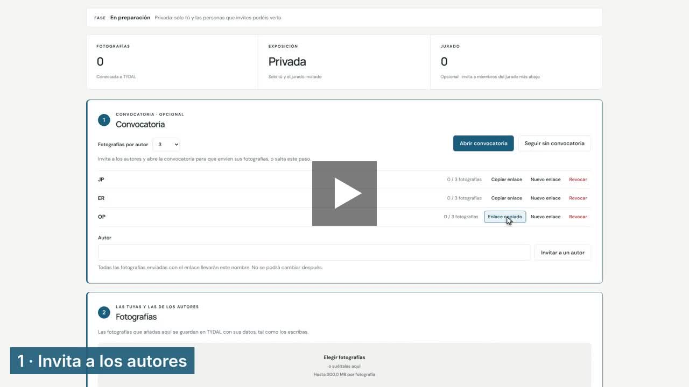
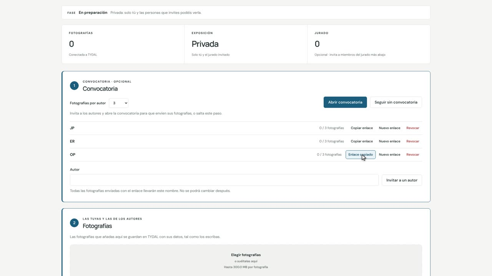
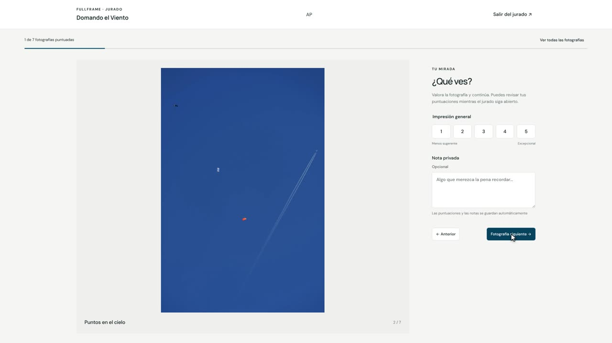
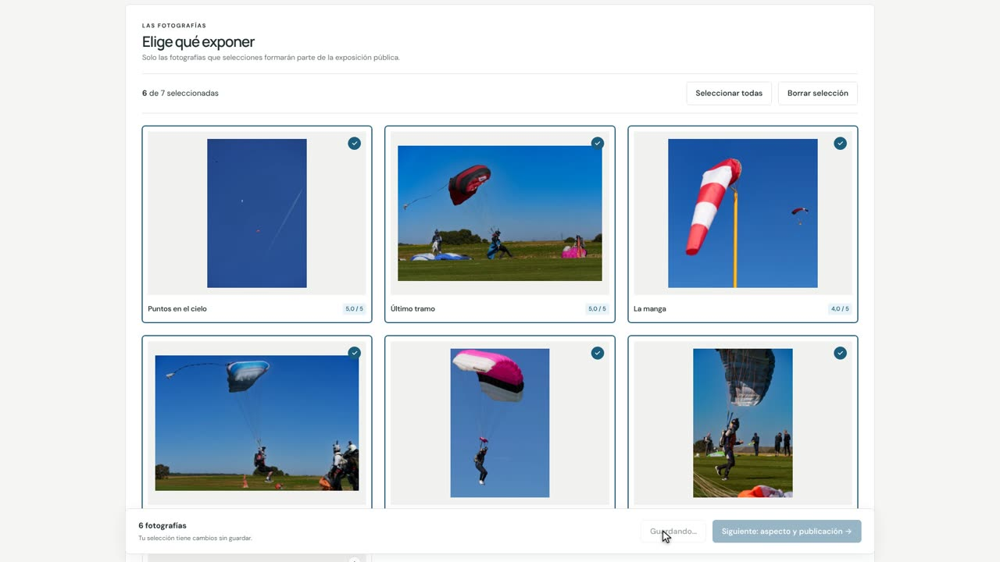
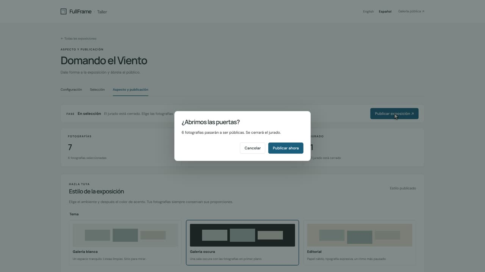

# Comisariar una exposición

*Ayuda de FullFrame · [English](curating-an-exhibition.md) · [PDF](https://eonity.org/fullframe-guides/pdf/comisariar-una-exposicion.pdf)*

Como comisario preparas la exposición en el **taller** y la abres al público cuando está lista. Tu exposición ya viene preparada: tú solo añades personas, fotografías y textos. Nada se hace público hasta que tú lo decides.

*Ver: todo el proceso con Domando el Viento, en minuto y medio. [Paso a paso (6 min)](https://eonity.org/fullframe-guides/videos/curators-es.mp4).*

## Antes de empezar

En la página de inicio de FullFrame, haz clic en **Acceso al taller**. Entra con el correo y la contraseña que te ha dado tu organización. Busca tu exposición y haz clic en **Gestionar exposición**. Puedes cambiar el idioma del taller entre **English** y **Español**, arriba a la derecha.

## 1 · Invita a los fotógrafos

1. Elige cuántas fotografías puede enviar cada persona.
2. Escribe el nombre de un fotógrafo y haz clic en **Invitar a un autor**.
3. Haz clic en **Copiar enlace** y envíaselo por correo o mensaje. Cada persona tiene su propio enlace.
4. Cuando hayas invitado a todos, haz clic en **Abrir convocatoria**.

Los fotógrafos abren su enlace, añaden sus fotografías con un título y hacen clic en **Terminar**. No necesitan cuenta. Verás cuántas ha enviado cada uno, por ejemplo *2 / 3 fotografías*.

## 2 · Pide opinión a un jurado (opcional)

1. Cuando estén todas las fotografías, haz clic en **Cerrar convocatoria**.
2. Escribe el nombre de un miembro del jurado, haz clic en **Invitar a un miembro del jurado**, después en **Copiar enlace**, y envíaselo.
3. Haz clic en **Abrir el jurado**.

El jurado abre su enlace y da a cada fotografía una puntuación de 1 a 5. También puede escribir una nota privada que solo leerás tú. ¿Prefieres elegir sin jurado? Haz clic en **Seguir sin jurado**.

Cuando el jurado termine, haz clic en **Cerrar el jurado**.

## 3 · Elige y escribe

Abre la pestaña **Selección**.

1. Escribe una **Introducción** de una línea y un breve texto **Sobre esta exposición**. Elige la **Fotografía de portada**. Haz clic en **Guardar datos**.
2. Haz clic en las fotografías que quieres mostrar; cada una muestra la puntuación media del jurado para ayudarte. Haz clic en **Guardar selección**.

## 4 · Dale un aspecto y abre las puertas

Abre la pestaña **Aspecto y publicación**.

1. Elige un aspecto: una sala clara u oscura, el estilo de los títulos y un color de acento. La vista previa muestra tus fotografías reales. Haz clic en **Aplicar estilo**.
2. Haz clic en **Publicar exposición** y después en **Publicar ahora**. Tu exposición queda abierta a todo el mundo.

## Si cambias de idea

- **Para corregir un texto** (introducción, texto de la exposición, portada): edítalo en **Selección** y haz clic en **Guardar datos**. La exposición sigue abierta.
- **Para añadir o quitar fotografías**: haz clic en **Cerrar exposición** y después en **Volver a la preparación**. Haz los cambios, repite los pasos (el jurado solo valora lo nuevo) y vuelve a publicar. No pierdes nada de lo que hiciste antes.

## Más detalle

- [Comisariar una exposición](https://github.com/eonity-org/fullframe/blob/main/docs/user-guide/es/comisarios.md): la guía técnica completa en GitHub, incluida la conexión de una exposición y sus ajustes.
- Para las personas que invitas: [Enviar tus fotografías](https://github.com/eonity-org/fullframe/blob/main/docs/user-guide/es/autores.md) y [Formar parte de un jurado](https://github.com/eonity-org/fullframe/blob/main/docs/user-guide/es/jurado.md).
