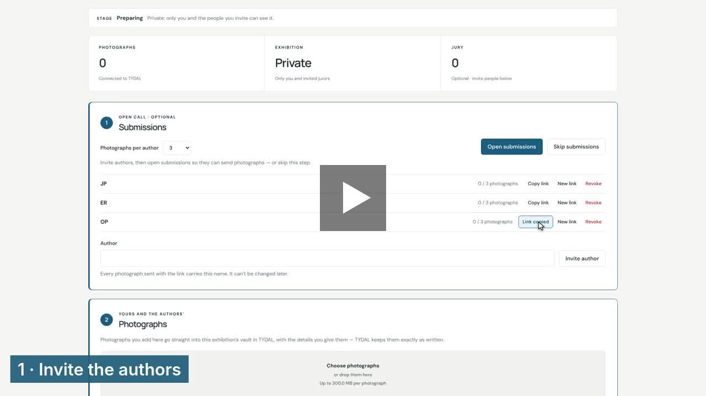
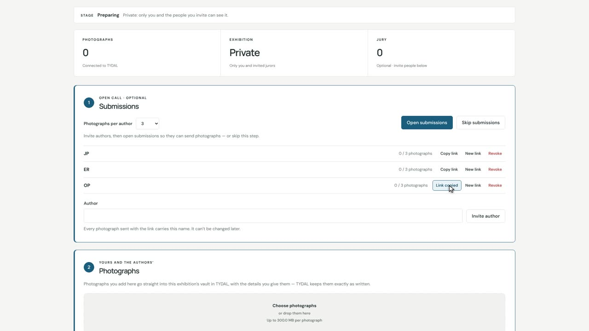
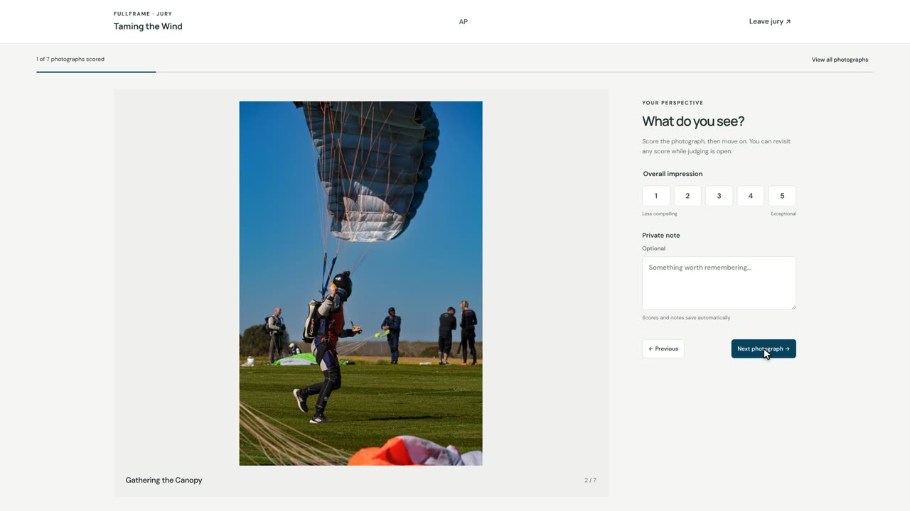
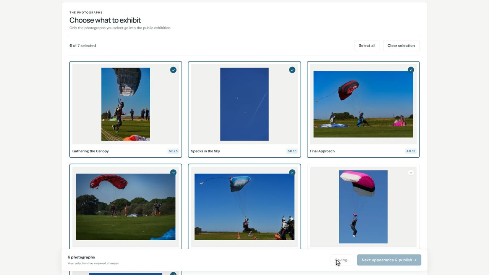
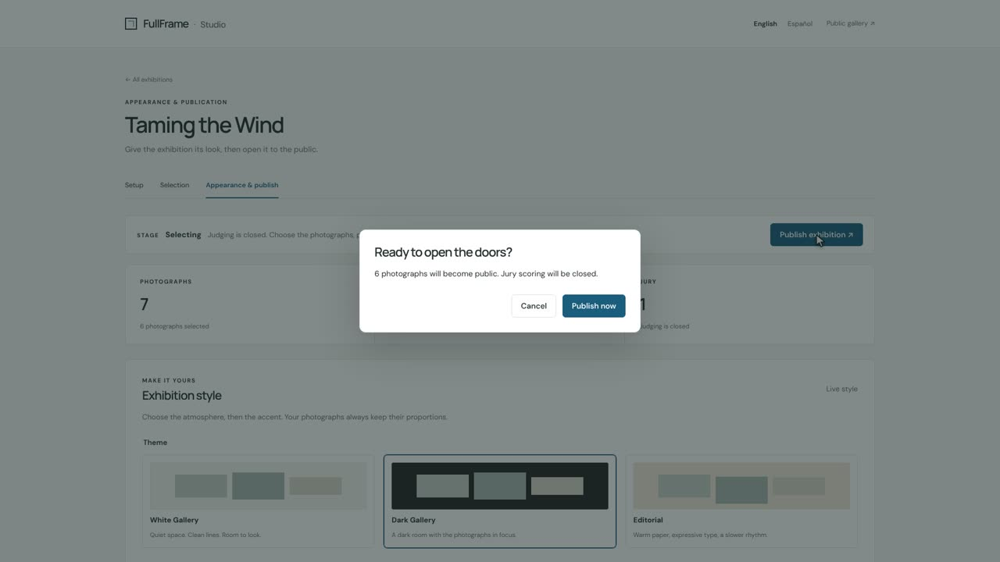

# Curating an exhibition

*FullFrame help · [Español](comisariar-una-exposicion.md) · [PDF](https://eonity.org/fullframe-guides/pdf/curating-an-exhibition.pdf)*

As a curator you prepare an exhibition in the **studio** and open it to the public when it's ready. Your exhibition is already set up for you: you only add people, photographs and words. Nothing goes public until you say so.

*Watch: the whole process on Taming the Wind, in a minute and a half. [Step by step (6 min)](https://eonity.org/fullframe-guides/videos/curators-en.mp4).*

## Before you start

Go to the FullFrame home page and click **Curator sign in**. Use the email and password your organisation gave you. Find your exhibition and click **Manage exhibition**. You can switch the studio between **English** and **Español** at the top right.

## 1 · Invite the photographers

1. Choose how many photographs each person can send.
2. Type a photographer's name and click **Invite author**.
3. Click **Copy link** and send that link to the photographer by email or message. Each person gets their own link.
4. When everyone is invited, click **Open submissions**.

The photographers open their link, add their photographs with a title, and click **Finish**. They don't need an account. You'll see each one's progress, for example *2 / 3 photographs*.

## 2 · Ask a jury for their opinion (optional)

1. When all the photographs are in, click **Close submissions**.
2. Type a juror's name, click **Invite juror**, then **Copy link** and send it to them.
3. Click **Start judging**.

Jurors open their link and give each photograph a score from 1 to 5. They can also write a private note that only you will read. Prefer to choose on your own? Click **Skip the jury**.

When the jurors are done, click **Close judging**.

## 3 · Choose and write

Open the **Selection** tab.

1. Write a one-line **Introduction** and a short text **About this exhibition**. Pick the **Cover photograph**. Click **Save details**.
2. Click the photographs you want to show; each one shows the jury's average score to help you. Click **Save selection**.

## 4 · Give it a look and open the doors

Open the **Appearance & publish** tab.

1. Pick a look: a light or dark room, the style of the titles and an accent colour. The preview shows your real photographs. Click **Apply style**.
2. Click **Publish exhibition**, then **Publish now**. Your exhibition is open to everyone.

## Changing your mind later

- **To fix a text** (introduction, about text, cover): edit it on **Selection** and click **Save details**. The exhibition stays open.
- **To add or remove photographs**: click **Close exhibition**, then **Back to preparing**. Make your changes, go through the steps again (the jury only scores what's new) and publish once more. Nothing you did before is lost.

## More detail

- [Curating an exhibition](https://github.com/eonity-org/fullframe/blob/main/docs/user-guide/en/curators.md): the complete technical guide on GitHub, including connecting an exhibition and its connection settings.
- For the people you invite: [Sending your photographs](https://github.com/eonity-org/fullframe/blob/main/docs/user-guide/en/authors.md) and [Being on a jury](https://github.com/eonity-org/fullframe/blob/main/docs/user-guide/en/jurors.md).
