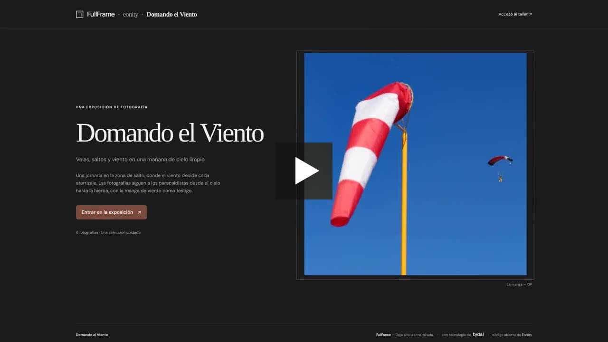
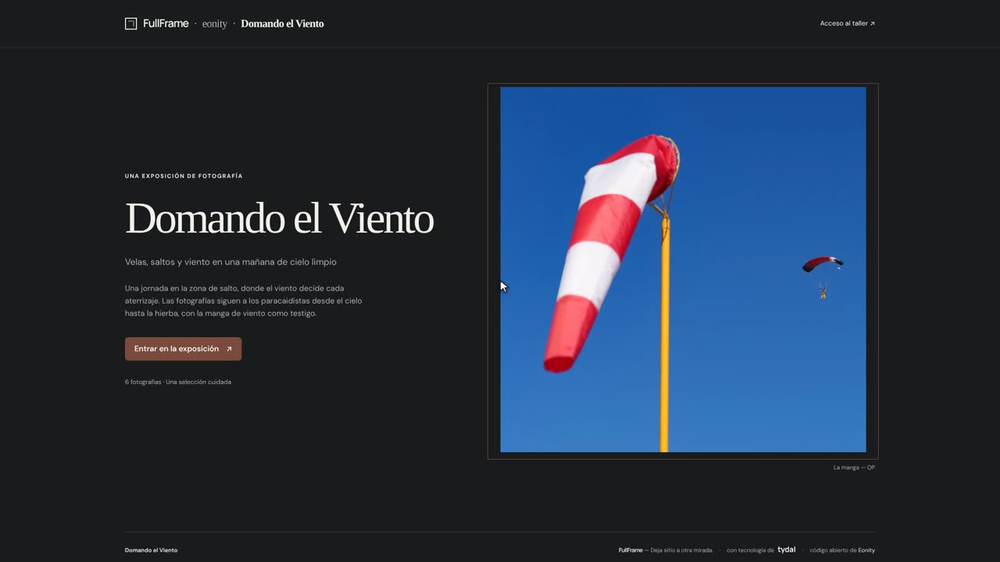
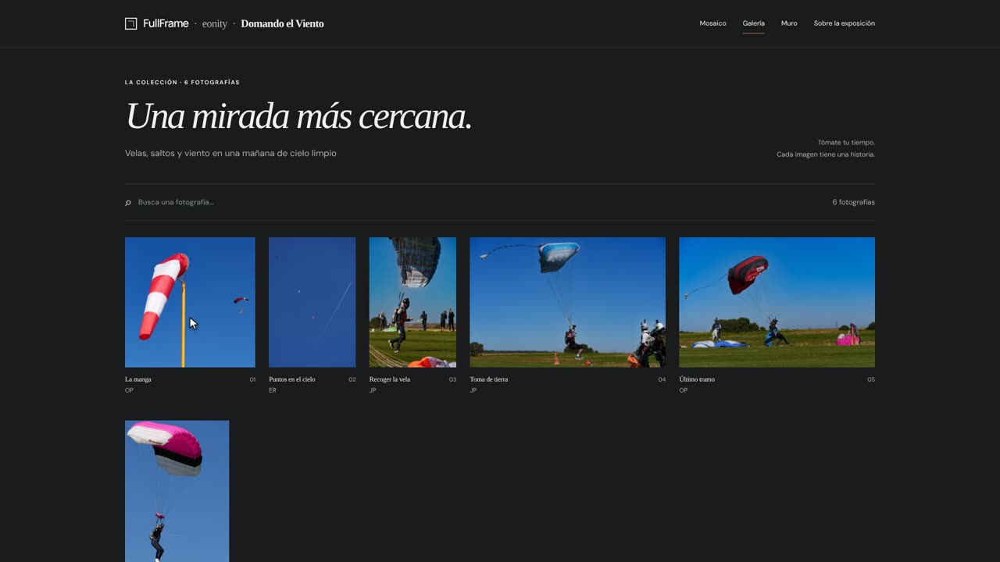
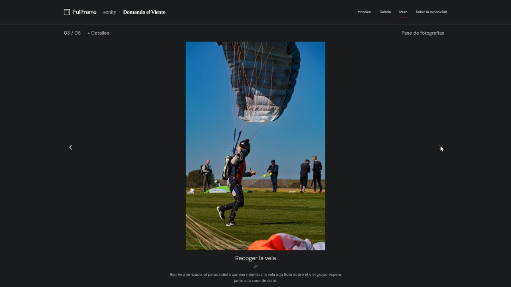

# Visitar una exposición

*Guía de uso de FullFrame · [English](visiting-an-exhibition.md) · [PDF](https://eonity.org/fullframe-guides/pdf/visitar-una-exposicion.pdf)*

No necesitas cuenta ni instalar nada. Abre el enlace de la exposición en cualquier navegador, desde el ordenador, la tableta o el móvil.

*Ver: una visita a Domando el Viento, en minuto y medio.*

## 1 · La entrada

Cada exposición empieza en su página de entrada: el título, una breve introducción, la historia de las fotografías y una imagen de portada. Haz clic en **Entrar en la exposición** para pasar.

## 2 · Elige cómo mirar

Arriba a la derecha puedes cambiar entre hasta tres formas de mirar. El comisario decide cuáles están disponibles.

- **Mosaico**: todas las fotografías juntas, una al lado de otra. Ideal para un primer vistazo.
- **Galería**: las fotografías con su título debajo y más espacio alrededor.
- **Muro**: una fotografía cada vez, tan grande como permita tu pantalla.

### Encuentra una fotografía

- **Buscar:** escribe una palabra en **Busca una fotografía…**. Busca en los títulos, los autores, las descripciones y las etiquetas.
- **Etiquetas:** si las fotografías tienen etiquetas, aparece un botón **Filtros +** junto al número de fotografías. Haz clic y elige una etiqueta para ver solo esas fotografías; vuelve a hacer clic en la etiqueta, o en **Todas las fotografías**, para verlas todas.
- **¿No aparece nada?** Haz clic en **Borrar búsqueda y filtros** para empezar de nuevo.

## 3 · Mira una fotografía de cerca

Haz clic en cualquier fotografía para abrirla en el **Muro**. Verás su título, el autor y, si la tiene, una breve descripción.

- Usa las flechas **‹** y **›** de los lados, o las flechas del teclado, para ir a la anterior o a la siguiente.
- Haz clic en **Pase de fotografías** para que cambien solas, más o menos cada cinco segundos. Haz clic en **Pausar** para detenerlo.

## 4 · Sobre la exposición

**Sobre la exposición** te devuelve a la página de entrada, donde puedes volver a leer la introducción y la historia de la exposición.

## Conviene saber

- Las fotografías nunca se recortan: siempre las ves tal como las encuadró su autor.
- FullFrame aparece en el idioma de la exposición. Los enlaces al pie de cada página llevan a la página de inicio de FullFrame, donde encontrarás otras exposiciones abiertas.

## Más detalle

- [Visitar una exposición](https://github.com/eonity-org/fullframe/blob/main/docs/user-guide/es/visitantes.md): la guía completa para visitantes en GitHub.
- [Guía de uso de FullFrame](https://github.com/eonity-org/fullframe/blob/main/docs/user-guide/es/README.md): todos los perfiles, en español e inglés.
