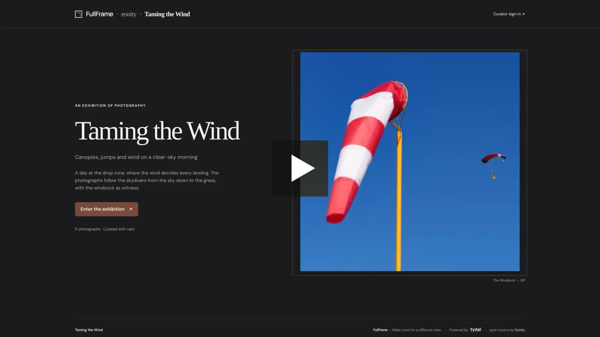
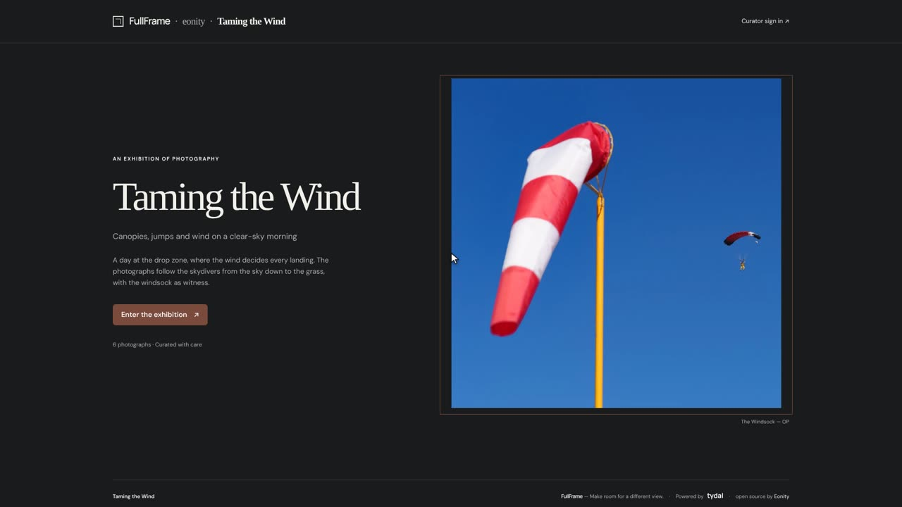
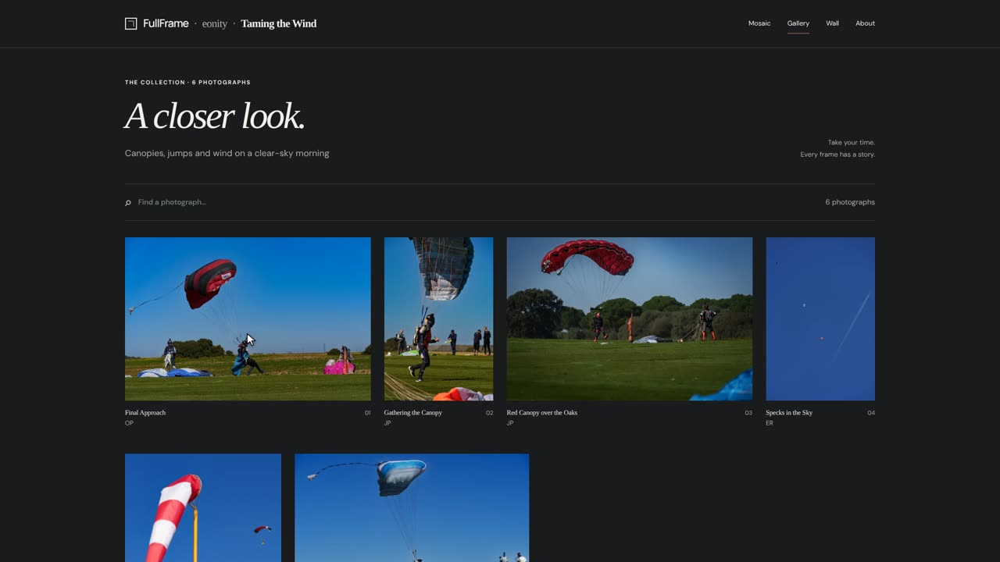
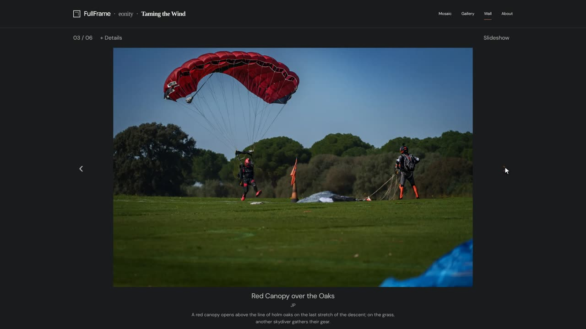

# Visiting an exhibition

*FullFrame user guide · [Español](visitar-una-exposicion.md) · [PDF](https://eonity.org/fullframe-guides/pdf/visiting-an-exhibition.pdf)*

You don't need an account or anything to install. Open the exhibition's link in any browser, on a computer, tablet or phone.

*Watch: a visit to Taming the Wind, in one minute.*

## 1 · The entrance

Every exhibition starts with its entrance page: the title, a short introduction, the story behind the photographs and a cover picture. Click **Enter the exhibition** to go in.

## 2 · Choose how to look

At the top right you can switch between up to three ways of looking. The curator decides which ones are available.

- **Mosaic**: all the photographs together, side by side. Good for a first look.
- **Gallery**: the photographs with their titles underneath, with more space around each one.
- **Wall**: one photograph at a time, as large as your screen allows.

### Find a photograph

- **Search:** type a word in **Find a photograph…**. It looks in the titles, the authors, the descriptions and the tags.
- **Tags:** if the photographs have tags, a **Filters +** button appears next to the photograph count. Click it and pick a tag to see only those photographs; click the tag again, or **All photographs**, to see everything.
- **Nothing found?** Click **Clear search and filters** to start again.

## 3 · Look at one photograph up close

Click any photograph to open it on the **Wall**. You'll see its title, the author and, if there is one, a short description.

- Use the **‹** and **›** arrows on each side, or the arrow keys on your keyboard, to move to the previous or next photograph.
- Click **Slideshow** to let the photographs change on their own, about every five seconds. Click **Pause** to stop.

## 4 · About the exhibition

**About** takes you back to the entrance page, where you can read the introduction and the story of the exhibition again.

## Good to know

- The photographs are never cropped: you always see them as the photographer framed them.
- FullFrame appears in the exhibition's language. The links at the bottom of every page lead to FullFrame's home page, where you can find other open exhibitions.

## More detail

- [Visiting an exhibition](https://github.com/eonity-org/fullframe/blob/main/docs/user-guide/en/visitors.md): the complete visitor guide on GitHub.
- [FullFrame user guide](https://github.com/eonity-org/fullframe/blob/main/docs/user-guide/en/README.md): every role, in English and Spanish.
